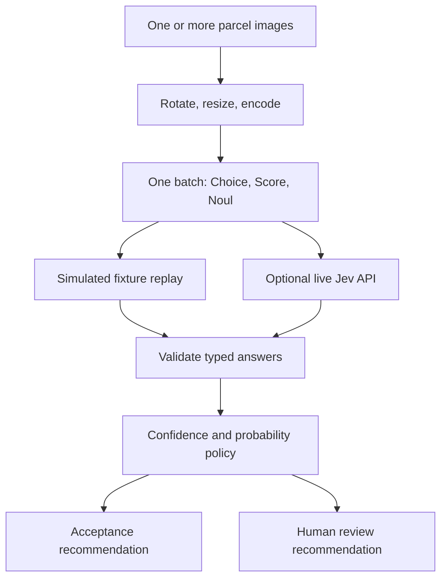

# Multimodal Decision Router

Inspect multiple views of a parcel with three independent typed questions, then use explicit confidence and probability thresholds to recommend acceptance or human review. A single request asks for the parcel's condition, damage severity, and likelihood that the evidence needs inspection. Keeping the recommendation policy in Python makes uncertain results visible and easy to test.

The default demonstration **replays simulated fixture scores** over two synthetic parcel images. It performs no model inference, has no image-understanding capability, makes no network calls, and requires no key. Optional live mode sends your own image evidence to the public TypeSafe Jev API.

This is an independent parcel-inspection example based on the documented multimodal interface. It does not claim to recreate an unavailable application's interface, unseen video code, or model results. Image support is experimental; the thresholds below are demonstration policy values, not measured calibration guarantees.



## Quick start

Requires Python 3.10 or later.

```bash
python -m venv .venv
# Linux/macOS/WSL:
source .venv/bin/activate
# Windows PowerShell instead: .venv\Scripts\Activate.ps1
python -m pip install -r requirements.txt
python app.py demo
python app.py demo --scenario uncertain
python -m unittest discover -s tests -v
```

The confident fixture recommends `accept_recommendation`; the uncertain fixture recommends `human_review`. Both reports label their scores as simulated and report two image views and three questions in one request. The two demonstrations intentionally use the same synthetic images: changing the fixture changes scores, not the image pixels.

## Optional live mode

Obtain a TypeSafe API key and export it in the same terminal. `.env.example` documents the variable; the program does not automatically load `.env` files.

```bash
export TYPESAFE_API_KEY="your-key"
python app.py live /path/to/front.jpg /path/to/side.png
```

In PowerShell, set `$env:TYPESAFE_API_KEY = "your-key"` before the Python command. The API key is used only in the HTTPS authorization header. Live mode uses the pinned `jev-1.14.0` model unless `--model` selects another available model. Calls use your TypeSafe account and may incur charges. No live request is made by the tests.

Images are decoded with Pillow, rotated using EXIF orientation, resized to at most 1568 pixels per side, padded to at least 280 pixels per side, and encoded as baseline JPEG. Supply PNG or JPEG still images under 16 MiB each. Padding and resizing can affect small visual details. The encoded JSON request is limited to 32 MiB; use fewer or smaller images if that limit is exceeded. Each image receives a distinct UUID asset reference; the shared state includes all references once.

The live adapter uses the documented `POST https://api.typesafe.ai/v1/systemone` endpoint with `TypeSafe-Danger-Zone-Images: true`. Images are provided through `assets` entries with `type`, `format`, and `data_base64`. All three questions are sent in that request and evaluated independently by the service. No local model is bundled, and no claim of live API validation is made without a real key and successful response.

## Decision contract

| Question | API type | Result used by policy |
| --- | --- | --- |
| `condition` | Choice | `intact`, `damaged`, or `unclear`, plus separate confidence and per-option probabilities |
| `severity` | Score | Probability-weighted level from 0 through 2, plus confidence, legend, and distribution |
| `needs_review` | Noul | Probability of a yes answer from 0 through 1; no separate confidence field |

The validator checks response question names and types, finite numeric values, declared outcomes, probability sums, the selected outcome's probability, score expectation, and the rubric legend. Invalid responses fail without generating a recommendation. Provider confidence metadata and the selected option's probability are different signals; both are checked independently. The severity policy uses the expected rubric score and the provider's score confidence metadata.

An acceptance recommendation requires `condition == intact`, selected condition probability at least `0.8`, condition and severity confidence at least `0.8`, severity below `1`, and human-review probability below `0.2`. Every other valid result goes to human review. The program prints a recommendation and its reasons; it performs no approval, shipping, or other external action.

## CODE MAP

| File | Responsibility and connections |
| --- | --- |
| `app.py` | CLI entry point; draws synthetic demo views, chooses fixture or live transport, validates the answers, and prints the recommendation. |
| `assets.py` | Loads and prepares images, assigns UUID references, and builds the shared image state and all three typed questions. |
| `client.py` | Reads fixed fixture responses or submits one authenticated request to the documented TypeSafe endpoint; rejects oversized requests and reports safe errors. |
| `decisions.py` | Validates API answer shapes and distributions, then applies the review thresholds without external side effects. |
| `fixtures/confident.json` | Explicitly simulated high-confidence response; exercises the acceptance branch. |
| `fixtures/uncertain.json` | Explicitly simulated ambiguous response; exercises the review branch. |
| `tests/test_boundaries.py` | Verifies both branches, confidence/probability boundaries, invalid model output, image preparation, and the exact live HTTP contract with mocked transport. |
| `requirements.txt` | Pillow dependency for image preparation and synthetic demo views. |
| `.env.example` | Placeholder configuration for optional live mode. |
| `.gitignore` | Excludes environment files, bytecode, generated data, and build artifacts. |

## References

- [TypeSafe image API and examples](https://docs.typesafe.ai/images)
- [API reference](https://docs.typesafe.ai/api)
- [Machine-readable OpenAPI contract](https://api.typesafe.ai/openapi.json)
- [TypeSafe Python SDK](https://github.com/typesafe-ai/typesafe-sdk-python)

API details were checked on 16 October 2026. Experimental image behavior and limits can change between releases.
